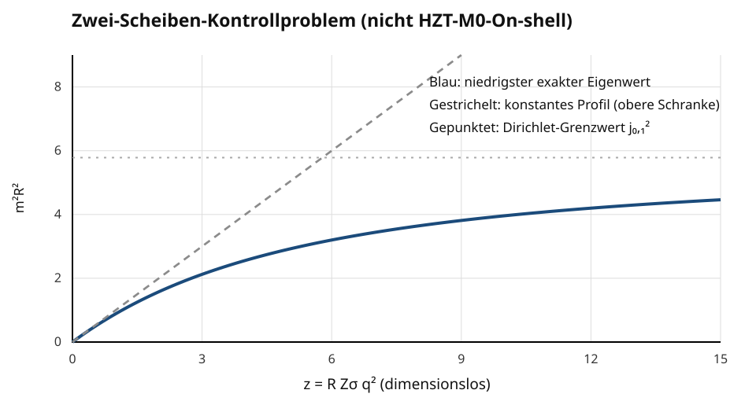

# Entscheidungsübersicht

**Dokumentkennung:** `UL-GRQM-2T04`; **Version:** `v0.1`; **Datum:** `2026-11-27`.

**Status:** `DRAFT_ANALYTIC_ONLY / NONCANONICAL`.

**Architektur:** HPVS $\rightarrow$ HZT-M0 $\rightarrow$ HZT-Full. Untersucht wird allein der dokumentierte **einzeitige** Zweig `HZT-M0-S6-C-PHYS-M1` mit Signatur $(-,+,+,+,+,+)$. Keine zweite Zeit wird in diese Wirkung hineingedeutet.

**Physikalische Evidenzwirkung:** `NONE`; **Freigabewirkung:** `NONE`; **K1-D:** `NOT_RELEASED`; **K1-E:** `NOT_ADMISSIBLE`; **vollständige Ghostfreiheit:** `OPEN`; **autorisierter physikalischer Solver:** `FALSE`.

**Kernergebnis (unter expliziten Annahmen):** Für eine festgehaltene 6D-Warpmetrik und einen transversalen Bulk-U(1)-Vektorsektor folgt ein Sturm-Liouville-Problem mit $p_V=e^{2A}LZ_F$ und $w_V=LZ_F$. Die in der Parentwirkung **bereits vorhandene** Kappenphase liefert bei $Z_\sigma q_\sigma^2>0$ eine positive Robin-Randform. Im geschlossenen, regulären Zwei-Regionen-Sektor ist der konstante masselose Vektormodus dann **keine** Eigenmode. Ein einfaches konstant-radiales 4D-Profil liefert lediglich eine obere Schranke für die niedrigste Modenmasse. Ein vollständig gekoppeltes M0-Spektrum ist **nicht** berechnet.

**Neuer wissenschaftlicher Befund:** Die Kapplandung und die Stromkopplung der Phase sind aus der M0-Parentwirkung definiert; **gewöhnliche baryonische Materie** ist im hier geprüften Parent nicht mit einer auswertbaren separaten Materiewirkung vorgegeben. Es wäre unzulässig, einen aus dem Cap-Sektor gewonnenen Vektormassenparameter als nachgewiesene Modifikation von RAR, BTFR, $\mu$, $\eta$ oder $\Sigma$ auszugeben.

# 1. Quellenbasis und genaue Geltungsgrenze

Direkt eingesehene UniverseLab-Quellen auf `main`:

1. `SCI-001-002_v0.1_Canonical_6D_Parent_Action_and_Boundary_Closure.md`, Git-Blob `df1b4a65d613622dcb176a2acc3879044292ac1e` – 6D-Parentwirkung, einzeitige Signatur, Maxwell- und Kappenvariation.
2. `registry/2026-08-03_HZT_M0_S6_C_PHYS_M1_FunctionFreezeContract_v0.1.json`, Git-Blob `13fbe0084dcf91f2d0696d00947c9eed221a58ce` – $U(\phi)$, $Z_F(\phi)$, $Z_\sigma$ und $q_\sigma$.
3. `registry/2026-09-07_UniverseLab_ULSH05_WP1_QuadraticActionReadiness_v0.1.json`, Git-Blob `6d18236526a9a2178b1a73e318e63e83a4d6ece6` – Kappenverschiebung, vollständige zweite Variation und Störungsreduktion bleiben offen.
4. `science/hzt-m0/md2s/2026-08-03_MD2S_BulkLocalizedActionAndJunctionLedger_v0.1.md`, Git-Blob `7bf51f38eae34254d855e82d96506a863990ccc7` – orientierte Junctions, Phasenladung und Vorzeichen.
5. `science/hzt-m0/bridge/MD2I_MDS05_WARP_VOLUME_BRIDGE_DERIVATION_v0.1.md`, Git-Blob `82a0587a8eb4a82ed21ed6225209976fd3dba0e7` – bedingte 4D-Gravitationsnormierung.

Externe Fachliteratur: Peloso, Sorbo und Tasinato (2006), *Standard 4D gravity on a brane in six-dimensional flux compactifications*, Phys. Rev. D **73**, 104025, DOI `10.1103/PhysRevD.73.104025`; Bars und Chen (2009), *Geometry and Symmetry Structures in 2T Gravity*, Phys. Rev. D **79**, 085021, DOI `10.1103/PhysRevD.79.085021`; Fu, Zhao und Sun (2022), *Gauge invariance and localization of vector Kaluza--Klein modes*, EPJC **82**, 102, DOI `10.1140/epjc/s10052-021-09983-z`.

Die Rechnungen unten sind **eigene algebraische Ableitungen** aus dem angegebenen Parent-Sektor. Die externe Literatur dient der Einordnung verwandter Konstruktionen, nicht als Quelle einer angeblich nachgewiesenen Identität zu M0.

## 1.1 Explizite Annahmen

- 6D-Bulk mit genau **einer** Zeit; zwei positive interne Raumrichtungen $(r,\chi)$, $\chi\sim\chi+2\pi$.
- Statische axialsymmetrische Hintergrundprofile $A_s(r_s)$, $L_s(r_s)$, $\bar\phi_s(r_s)$ und magnetisches $\bar F_{r\chi,s}\neq0$ in Regionen $s=N,S$.
- Gemeinsame codimension-1-Kappe $\Sigma_5$ mit $A_N=A_S$, $L_N=L_S=L_\Sigma>0$ und vereinbarter Gauge-Patch-Konvention; keine Verdoppelung ihrer lokalisierten Wirkung.
- Positive Bulk-Gaugefunktion $Z_F(\bar\phi)>0$, im aktiven M1-Winding-Sektor $Z_\sigma>0$, $q_\sigma\neq0$.
- Im betrachteten *eingeschränkten* transversalen Hessiansektor werden $\delta g_{MN}$, $\delta\phi$, $\delta A_r$ und $\delta A_\chi$ auf null gesetzt; die Kappenphase darf ihre 4D-Stückelberg-Fluktuation tragen. Das ist keine Behauptung einer konsistenten vollständigen S/V/T-Trunkierung.
- Der Hintergrund ist **nicht** als gelöste On-shell-Konfiguration nachgewiesen. Physikalische Massenvorhersagen werden daher ausdrücklich nicht freigegeben.

# 2. Ausgegangene Parentwirkung

Die wesentlichen Bestandteile der M0-Wirkung sind

\[
\begin{aligned}
S={}&\sum_s\int_{\mathcal M_s}\!d^6X\,\sqrt{-g_6}
\left[\frac{M_6^4}{2}(R_6-2\Lambda_6)
-\frac12(\nabla\phi)^2-U(\phi)-\frac14 Z_F(\phi)F_{MN}F^{MN}\right]\\
&+S_{\mathrm{GHY}}-\int_{\Sigma_5}\!d^5x\sqrt{-h}\left[\lambda(\phi)+\frac12Z_\sigma(\phi)D_a\sigma D^a\sigma\right],
\quad D_a\sigma=\partial_a\sigma-q_\sigma A_a.
\end{aligned}
\]

Im aktuellen M1-Funktionsvertrag gilt

\[
U(\phi)=\frac12\widehat m_\phi^2 M_6^6(\phi/M_6^2)^2,\qquad
Z_F(\phi)=\exp[-2a_F\phi/M_6^2],
\]
\[
\lambda(\phi)=\widehat\lambda M_6^5,\qquad
Z_\sigma(\phi)=\widehat z_\sigma M_6^3,
\qquad q_\sigma=m_\sigma q_{\rm ref}.
\]

Die 4D-Metrik $\bar g_{\mu\nu}(x)$ kann im Hintergrund maximal symmetrisch sein. Für den abgeleiteten transversalen Vektorsektor verwenden wir die 4D-kovariante Proca-Definition $\bar\nabla_\nu f^{\nu\mu}=m^2 a^\mu$; eine mögliche Krümmung ist darin bereits enthalten.

# 3. Radialer Maxwell-Operator direkt aus dem 6D-Term

Wir setzen

\[
ds_6^2=e^{2A_s(r_s)}\bar g_{\mu\nu}dx^\mu dx^\nu+dr_s^2+L_s(r_s)^2d\chi^2,
\quad \sqrt{-g_6}=e^{4A_s}L_s\sqrt{-\bar g_4}.
\]

Für die axialsymmetrische transversale Störung ist

\[
\delta A_\mu(x,r_s)=a_\mu(x)f_s(r_s),\qquad
\bar\nabla^\mu a_\mu=0,\qquad
\delta A_r=\delta A_\chi=0.
\]

Dann gelten $\delta F_{\mu\nu}=f_s(r_s)f_{\mu\nu}(x)$ und $\delta F_{r\mu}=f_s'(r_s)a_\mu(x)$.

Nach Winkelintegration erhält der eingeschränkte transversale Maxwell-Sektor die Form

\[
S_V^{(2)}=-\frac14\!\int d^4x\sqrt{-\bar g_4}\;\mathcal I[f]\,f_{\mu\nu}f^{\mu\nu}
-\frac12\!\int d^4x\sqrt{-\bar g_4}\;\mathcal E_{\rm bulk}[f]\,a_\mu a^\mu
+S_{\Sigma,V}^{(2)},
\]

mit

\[
\boxed{\quad\mathcal I[f]=2\pi\sum_s\int_0^{\rho_s}dr_s\,w_{V,s}f_s^2,\qquad
w_{V,s}=L_sZ_F(\bar\phi_s)\quad}
\]

und

\[
\boxed{\quad\mathcal E_{\rm bulk}[f]=2\pi\sum_s\int_0^{\rho_s}dr_s\,p_{V,s}(f_s')^2,\qquad
p_{V,s}=e^{2A_s}L_sZ_F(\bar\phi_s).\quad}
\]

Für Winkelharmoniken $e^{i\ell\chi}$ mit $\ell\in\mathbb Z$ käme in diesem festgehaltenen Sektor die zusätzliche positive Form $2\pi\sum_s\int dr_s\,e^{2A_s}Z_F\ell^2 f_s^2/L_s$ hinzu. Die weitere Herleitung konzentriert sich auf $\ell=0$.

**Dimensionsaudit** in Einheiten $\hbar=c=1$: $[A_M]=M^2$, $[q_\sigma]=M^{-1}$, $[Z_\sigma]=M^3$, $[L]=M^{-1}$, $[dr]=M^{-1}$. Für dimensionslose Profile $f_s$ gilt $[\mathcal I]=M^{-2}$ und $[\mathcal E]=M^0$; daher hat $m^2=\mathcal E/\mathcal I$ die Dimension $M^2$.

# 4. Die Kappenphase liefert eine Randmasse

Setze $\sigma(x,\chi)=N_\sigma\chi+s(x)$, wobei $s$ die axisymmetrische 4D-Phasenstörung bezeichnet. Der 4D-Anteil des Kappenterms lautet

\[
S_{\Sigma,V}^{(2)}=-\frac12 C_\sigma\int d^4x\sqrt{-\bar g_4}\;
[\partial_\mu s-q_\sigma f_\Sigma a_\mu]
[\partial^\mu s-q_\sigma f_\Sigma a^\mu],
\]

\[
\boxed{C_\sigma=2\pi e^{2A_\Sigma}L_\Sigma Z_\sigma>0.}
\]

Bei $\delta a_\mu=\partial_\mu\alpha$, $\delta s=q_\sigma\alpha$ ist der Ausdruck für ein **konstantes, auf $f_\Sigma=1$ normiertes** Gaugeprofil invariant. Für die volle radiale Modenexpansion muss die gesamte Eichstruktur einschließlich $A_r$ berücksichtigt werden; einzelne massive Moden sind nicht jeweils frei als isolierte Maxwell-Eichfelder anzusehen.

Für den **transversalen** Anteil entfällt die lineare Mischform mit $\partial_\mu s$ nach 4D-partieller Integration. Die zugehörige positive Randform ist

\[
\boxed{b_V=2\pi e^{2A_\Sigma}L_\Sigma Z_\sigma q_\sigma^2>0.}
\]

Damit wird die eingeschränkte radiale Energie

\[
\boxed{\mathfrak q_V[f]=2\pi\sum_s\int_0^{\rho_s}p_{V,s}(f_s')^2dr_s+b_V f_\Sigma^2.}
\]

Die Winkel-Wicklung $N_\sigma$ steht nicht direkt in $b_V$; sie beeinflusst den Hintergrund, seine Zulässigkeit, Mischungen und damit die letztliche Spektralgeometrie. Der Term $b_V$ folgt aus der *vierdimensionalen* kovarianten Ableitung der Kappenphase.

## 4.1 Randbedingungen aus der Variation

Variation der Quadratform bei festem $\mathcal I[f]$ gibt in jeder Region

\[
\boxed{-(p_{V,s}f_s')'=m_n^2w_{V,s}f_s}
\]

und an der gemeinsamen Kappe bei stetigem $f_\Sigma$ die orientierte Robin-Junction

\[
\boxed{\quad\sum_{s=N,S}n_s^{r_s}\,p_{V,s}(\rho_s)f'_s(\rho_s)+b_V f_\Sigma=0.\quad}
\]

Die Radial-Normalen werden gemäß dem Projektvertrag jeweils **aus der zugehörigen Region heraus** gewählt. Die Kappe wird genau einmal gezählt. Glatte Pole erfordern reguläre axialsymmetrische Moden.

Ohne aktivierten Phasensektor ($b_V=0$) ist $f_s=\mathrm{const}$ mit $m=0$ kinematisch zulässig. Für $b_V>0$ erfüllt es die Junction-Bedingung **nicht**, sofern es nicht verschwindet. Ein konstant radiales Profil darf darum nicht ohne Nachweis als exakte physikalische Eigenfunktion behauptet werden.

## 4.2 Exakter Quotient und notwendige Positivität

Unter Selbstadjungiertheit, regulären Polen, kompakter verbundener Domäne und positivem Gewicht folgt aus dem Eigenproblem

\[
\boxed{\quad m_n^2=\frac{\mathfrak q_V[f_n]}{\mathcal I[f_n]}\ge0.\quad}
\]

Falls $b_V>0$, $f_N=f_S$ an der Kappe und keine andere Randkomponente eine unabhängige Konstantenmode trägt, kann Gleichheit nur für $f_n=0$ gelten. Der isolierte transversale Operator besitzt unter diesen Voraussetzungen **keine masselose Eigenmode**.

Wichtig: Positivität dieser Teilform ist **kein** Beweis der positiven vollständigen kinetischen Form der gekoppelten Gravitation/Maxwell/Skalar-/Kappenstörungen. Insbesondere kann der magnetische Hintergrund $\bar F_{r\chi}$ mit $\delta g_{\mu\chi}$ koppeln.

## 4.3 Weshalb die konstante Profilformel nur eine obere Schranke liefert

Für $f=1$ als zulässige **Testfunktion der Quadratform** (nicht als Eigenfunktion der Robin-Operator-Domäne) ist

\[
\boxed{\quad m_0^2\le \frac{b_V}{\mathcal I[1]}\equiv m_{\mathrm{const}}^2.\quad}
\]

Bei $b_V>0$ und einem nicht entarteten verbundenen glatten Radialproblem ist die Ungleichung im üblichen Fall **streng**, weil $f=1$ die notwendige Robin-Eigenbedingung nicht erfüllt. Frühere 4D-Konstantprofil-Formeln dürfen daher lediglich als *Rayleigh-Ritz-Oberschranke* beziehungsweise niedrige Trunkierungsnäherung verstanden werden.

# 5. Analytisch lösbares Zwei-Scheiben-Kontrollproblem

**Nur hergestellter mathematischer Referenzfall, keine HZT-M0-On-shell-Lösung.** Zwei identische flache Scheiben werden an einer gemeinsamen Kappe bei Radius $R$ formal zusammengefügt; in jeder Scheibe $A=0$, $L=r$, $Z_F=1$. Die glatten Scheibenpole erzwingen reguläre Besselfunktionen.

Die axialsymmetrische radiale Gleichung lautet

\[
-(rf')'=m^2rf,\qquad f(r)=J_0(mr).
\]

Für den symmetrischen Modenkanal lautet die Kappen-Junction, nach Herausheben des gemeinsamen Faktors $2\pi$,

\[
2R f'(R)+Rc f(R)=0,\qquad c=Z_\sigma q_\sigma^2>0.
\]

Setzt man $x=mR$ und $z=cR$, so ergibt sich die **exakte charakteristische Gleichung**

\[
\boxed{\quad2xJ_1(x)=zJ_0(x).\quad}
\]

Sie besitzt für $z>0$ eine kleinste positive Wurzel $0<x<j_{0,1}$; für $z=0$ ist $x=0$ eine Nullmode. Die niedrigste Modenmasse ist $m_0=x/R$.

| $z=cR$ | $x=m_0R$ | $m_0^2R^2$ | Konstantes Profil, obere Schranke |
|---:|---:|---:|---:|
| 0 | 0 | 0 | 0 |
| 0,01 | 0,099938 | 0,009988 | 0,0100 |
| 0,1 | 0,314262 | 0,098760 | 0,1000 |
| 0,5 | 0,685588 | 0,470030 | 0,5000 |
| 1 | 0,940771 | 0,885049 | 1,0000 |
| 4 | 1,599449 | 2,558238 | 4,0000 |
| 10 | 1,989815 | 3,959363 | 10,0000 |

Aus $J_0(x)=1-x^2/4+\cdots$ und $J_1(x)=x/2-x^3/16+\cdots$ folgt für $z\ll1$:

\[
\boxed{\quad m_0^2R^2=z-\frac{z^2}{8}+O(z^3).\quad}
\]

Für $z\rightarrow\infty$ folgt $x\rightarrow j_{0,1}=2{,}4048255\ldots$; die Kappe nähert sich einer Dirichlet-Bedingung. Das Massenspektrum sättigt in diesem Referenzfall, während die Konstantprofil-Obergrenze unbegrenzt weitersteigt.

Bei festem $z$ gilt $m_0\propto R^{-1}$. Hält man stattdessen $c$ fest, ändert sich beim Variieren von $R$ auch $z=cR$; ein universelles inverses Radiusskalengesetz ohne weitere Voraussetzungen ist damit nicht gezeigt.

# 6. Vierdimensionaler Kopplungs- und Normierungsvertrag

Für einen beliebigen formal normalen Modenansatz gilt

\[
\mathcal N_n=2\pi\sum_s\int_0^{\rho_s}\!dr_s\,L_sZ_Ff_{n,s}^2,
\qquad a_{\mu,n}^{\rm can}=\sqrt{\mathcal N_n}\,a_{\mu,n}.
\]

Die Kappenphase besitzt den 4D-Kinetikkoeffizienten $C_\sigma$ aus Abschnitt 4. Ihre **formal** normierte Kopplung an den $n$-ten Vektor besitzt die Struktur

\[
\boxed{\quad q_{n,\Sigma}^{\rm eff}=\frac{q_\sigma f_n(\rho)}{\sqrt{\mathcal N_n}},\qquad
\mu_{n,\Sigma}=\sqrt{C_\sigma}\,q_{n,\Sigma}^{\rm eff}.\quad}
\]

Die Produkte $\mu_{n,\Sigma}$ können aufgrund der gemeinsamen Kappenphase Moden untereinander mischen. Vor der physikalischen Interpretation ist also ein **vollständiges diagonales System** einschließlich longitudinaler Bulkkomponenten und metrischer Vektorfluktuationen erforderlich.

Dieser Vertrag betrifft ausdrücklich die **in der Parentwirkung vorhandene Kappenphase**. Eine separat freigegebene 4D-Wirkung gewöhnlicher Materie, ihre Ladungen und das Verhältnis zum beobachtbaren Elektromagnetismus fehlen. Deshalb werden keine experimentellen Ladungen oder Kopplungen erfunden.

# 7. Separater Bulk-Skalar: Vorzeichen und notwendige Mischungen

Im formal auf $\delta g=\delta A=0$ festgehaltenen Skalar-Hessian folgen aus dem kanonischen Bulk-Skalarterm

\[
\boxed{\quad w_{\phi}=e^{2A}L,\qquad p_{\phi}=e^{4A}L.\quad}
\]

Der lokale rein skalare Quadratterm enthält

\[
\mathcal M_{\rm loc}^2=U''(\bar\phi)+\tfrac14 Z_F''(\bar\phi)\,\bar F_{MN}\bar F^{MN}.
\]

Mit $\rho_F=\tfrac14 Z_F\bar F^2\ge0$ und den M1-Funktionen ist

\[
\boxed{\quad \mathcal M_{\rm loc}^2=\widehat m_\phi^2 M_6^2+
\frac{4a_F^2}{M_6^4}\rho_F\ge0.\quad}
\]

**Achtung:** Auch bei positiver lokaler Hessian-Komponente bleibt der gekoppelte Skalar-Vektor-Gravitations-Hessian offen. Hintergrundflux erzeugt insbesondere $\delta\phi\,\delta F_{r\chi}$- und metrische Mischungen. Die Kappenverschiebung ist noch nicht vollständig abgeleitet. Die Positivität von $\mathcal M_{\rm loc}^2$ beweist weder einen positiven physischen Skalarmassen-Eigenwert noch Ghostfreiheit.

# 8. Gravitationssektor und fehlende Materiewirkung

Der verifizierte Einstein-Hilbert-Warpkoeffizient lautet lediglich konditional

\[
\boxed{M_4^2=M_6^4V_W,\qquad V_W=2\pi\sum_s\int dr_s\,L_s e^{2A_s}.}
\]

Eine freie vierdimensionale Tensor-Nullmode erfordert zusätzlich eine physikalisch zulässige, nach den vollständigen Einstein-/Israel-Gleichungen und der Spin-2-Quadratik normalisierte Lösung. Die positive Zahl $V_W$ garantiert das nicht.

Die für das Observableprogramm benötigte gewöhnliche Materieperturbation $\Delta_m$ sowie die materielle Kopplung an 4D-Tensor- und Skalarmoden sind laut `ULSH05_WP1_QuadraticActionReadiness` **MISSING_REQUIRED_LINK**. Deswegen ist aus diesem Dokument keine numerische oder konzeptionell abschließende Berechnung von

\[
\mu(k,z),\quad \Sigma(k,z),\quad\eta(k,z),\quad E_G,\quad f\sigma_8
\]

möglich. Dass ein formal berechenbarer Vektormodenzweig existiert, ist keine Bestätigung einer Gravitationstheorie.

# 9. Verhältnis zu 2T-03 und zur Bars-Shadow-Theorie

Ein 4D-Weyl-Lift aus `2T-03` ist eine lokale Feldumschreibung. Er garantiert nicht die Gleichheit physikalischer Spektren, ihrer Residuen und Materiekopplungen.

Bars und Chen beschreiben ausdrücklich einen anderen Mechanismus: Die zusätzlichen 2T-Koordinaten werden durch Eichsymmetrien und Zwangsbedingungen reduziert; gewöhnliche unabhängige Kaluza-Klein-Moden werden dort nicht wie bei einer räumlichen M0-Kompaktifizierung erzeugt. Die sogenannten Prolongationen sind im beschriebenen Shadow-Formalismus vom Schattenzustand bestimmt. Dies ist ein **potenzieller physikalischer Strukturunterschied**, keine automatische Widerlegung einer gemeinsamen tieferen Theorie.

Ein konkreter Vergleich erfordert auf **beiden** Seiten die eindeutigen physischen Freiheitsgrade, das vollständig diagonalisierte Spektrum und definierte Kopplungen an *dieselbe* Quellklasse. Nur wenn die Quellen und Eichsektoren identifiziert sind, können Polstellen und Residuen in einer 4D-Antwortfunktion wie

\[
\mathcal G_{JJ}(p^2)\sim\sum_n\frac{g_n^2}{p^2+m_n^2}
\]

überhaupt sinnvoll verglichen werden. Hier sind $g_n$ nicht aus beobachteter Materie hergeleitet, also bleibt die formale Vergleichsidee vorerst nicht testbar.

# 10. Kritische Gegenprüfungen und Grenzen

**Gegenbeispiel 1 – Konstantes Profil ist kein Eigenmodus.** Aktive Kappenphase liefert $b_V>0$ und damit $\sum p f'_s+b_V f_\Sigma=0$. Ein nichtverschwindendes konstantes $f$ scheitert an dieser Gleichung.

**Gegenbeispiel 2 – Falsche Massengleichsetzung.** Im Zwei-Scheiben-Test bei $z=1$ ist $m_0^2R^2=0{,}885049\ldots$, nicht $1$, obwohl das konstante Profil genau die obere Schranke $1$ liefert.

**Gegenbeispiel 3 – Kinetische Positivität eines Teilsektors genügt nicht.** Positive Gewichte $w_V,p_V$ sagen nichts über nicht berücksichtigte gravitomagnetische Vektormischungen, Feldraum-Zwänge oder einen eventuell negativen Eigenwert des physischen reduzierten Gesamthessians.

**Gegenbeispiel 4 – Nullmodus der Eichtheorie bei $q_\sigma=0$.** Für eine deaktivierte Kappenladung $q_\sigma=0$ oder $Z_\sigma=0$ verschwindet $b_V$. Der konstante Nullmodus kann dann wieder erscheinen; der Befund ist damit ausdrücklich sektorabhängig.

**Gegenbeispiel 5 – Identifikation mit Elektromagnetismus.** Ein Maxwell-Feld im sechsdimensionalen Parent ist nicht automatisch das auf einer 4D-Welt gemessene Photon. Ohne Materiewirkung, Ladungszuordnung und korrekten Zero-Mode-Nachweis ist diese Identifikation unzulässig.

# 11. Testprotokoll und Freigabematrix

Die mitgelieferte Python-Datei verwendet SymPy, SciPy und NumPy. Sie enthält **27 lokale Tests** für Volumenelemente, Warpfaktoren, Randphase, Funktionsableitungen, dimensionsrichtige Normierungen, analytische Bessel-Gleichung, Grenzwerte, Rayleigh-Ritz-Schranke und kontrollierte Daten-/Materie-Firewalls. Der exakt lösbare Zwei-Scheiben-Test wird mittels unabhängiger numerischer Quadratur erneut in die Rayleigh-Form eingesetzt.

Die Tests sind **nicht** die Validierung des physikalischen HZT-M0-On-shell-Hintergrunds. Ein erfolgreicher Test entspricht nur der Aussage, die der jeweilige Test ausdrücklich implementiert.

| Gate | Stand 2T-04 | Begründung |
|:--|:--|:--|
| V-01: Maxwell-Gewichte | PASS (analytischer Teilsektor) | Variations-/Indexalgebra |
| V-02: Kappen-Robinform | PASS (Teilsektor) | Kappenwirkung und orientierte Variation |
| V-03: Zwei-Scheiben-Test | PASS (manufactured) | Bessel-Eigenwert und Rayleigh-Quotient |
| V-04: Modellinterne physische Massenzahl | OPEN | On-shell-Hintergrund und vollständige Vektormischung fehlen |
| S-01: lokaler Skalar-Hessian | PASS (eingeschränkte Variante) | Festgehaltene Hintergrundfelder |
| S-02: physische skalare Mode | OPEN | Koppelte S/V/T-Zwänge fehlen |
| T-01: positive formale Warp-Norm | CONDITIONAL | Vollständiger Spin-2-Randoperator fehlt |
| O-01: Materie-Observable-Map | BLOCKED | Materiewirkung und Source-Binding fehlen |
| Q-01: volle Ghostfreiheit | OPEN | Physische Kinetik nach Zwangelimination fehlt |
| K1-D / K1-E | NOT RELEASED / NOT ADMISSIBLE | Governance unverändert |

# 12. Nächster wissenschaftlich zulässiger Block

`UL-GRQM-2T05 – Gekoppelter Vektor-/Gravitationssektor, linearisierte Maxwell-Israel-Randbedingungen und Modenprojektion`.

**Minimaler Satz notwendiger Eingaben:** ein tatsächlich freigegebener statischer Parent-Hintergrund $\{A,L,\bar\phi,\bar F,\rho_s\}$; vollständige Cap-Bending-/Embedding-Variationen; 6D-Metrik-Vektorfluktuationen; gauge-invariante Kombinationen aus $A_\mu$, $g_{\mu r}$, $g_{\mu\chi}$ und $\sigma$; Zwangselimination; vollständig definierte Funktionsräume und globale Patchbedingungen. Kein empirischer Claim ohne Materiekopplung und Forward Map.

**Abschlussentscheidung:** `ANALYTIC_PARTIAL_PASS; PHYSICAL_RELEASE_NONE`. Die vorhandene HZT-M0-Kappenphase liefert eine echte mathematische Einschränkung des isolierten 4D-Vektorspektrums. Die gesamte Theorie ist dadurch weder bestätigt noch widerlegt.