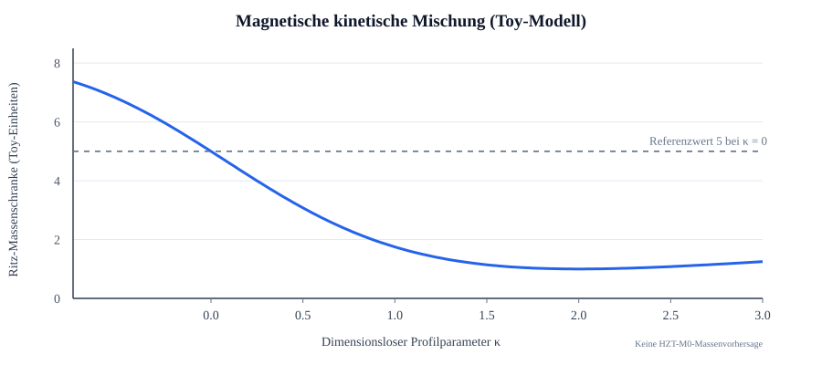

# Status und Entscheidung

**Forschungs-ID:** `UL-GRQM-2T06` · **Version:** v0.1 · **Erstellung:** 2026-11-27  
**Modell:** `HZT-M0-S6-C-PHYS-M1`, **Signatur:** $(-,+,+,+,+,+)$; **nicht** HZT-Full.  
**Freigabestatus:** `DRAFT_ANALYTIC_ONLY / NONCANONICAL`  
**Physical evidence effect:** `NONE` · **Physical gate effect:** `NONE` · **Solver-/Grant-Autorisierung:** `FALSE`.  
**K1-D:** `NOT_RELEASED` · **K1-E:** `NOT_ADMISSIBLE` · **Full ghost freedom:** `OPEN`.

**Kernresultat.** Die 6D-Einstein-Hilbert- und Maxwell-Terme ergeben im eingeschränkten kreisisometrischen Kaluza-Klein-Ansatz eine explizite symmetrische $2\times2$-Kinetikmatrix für den transversalen Bulk-Maxwell-Vektor $B_\mu$ und den Graviphoton-Vektor $C_\mu$. Im Bereich $M_6^4>0$, $L>0$, $Z_F>0$ ist diese Matrix punktweise positiv definit. Die vorhandene Kappenphase erzeugt einen positiven Randmassenterm vom Rang eins. Das hier definierte **eingeschränkte** selbstadjungierte Sturm-Liouville-System lässt dann lokal einen konstant-radialen Nullmoden-Kandidaten in der orthogonalen Linearkombination zu. **Weder** ist die vollständige Einstein-Maxwell-Constraint-Elimination durchgeführt **noch** ist der Nullmodenkandidat als physikalischer 4D-Vektor bestätigt.

**Wichtigster methodischer Befund:** Es ist möglich, die gesamte *eingeschränkte Zwei-Vektor-Hessianform* einschließlich gravitativer Kreis-Kopplung und Kappenform abzuleiten, **ohne** zu behaupten, damit schon den vollständigen 6D-S/V/T-Hessian hergeleitet zu haben. Die fehlenden $g_{\mu r}$-, $B_r$-, $C_r$-, Cap-Bending-, Normalbündel- und Quellsektoren sind im Folgenden explizit gekennzeichnet.

# 1. Quellenprovenienz und Modellidentität

Direkt eingesehene, öffentlich zugängliche UniverseLab-Quellen (jeweils `main`, Blob-SHA aus der aktuellen Quellenprüfung):

1. [SCI-001/002: 6D Parent Action and Boundary Closure](https://github.com/stefanhasselm74314-byte/UniverseLab/blob/main/SCI-001-002_v0.1_Canonical_6D_Parent_Action_and_Boundary_Closure.md) (`df1b4a65d613622dcb176a2acc3879044292ac1e`). Einzeitige Signatur, Einstein-Maxwell-Skalar- und Kappenwirkung, Outward-Normal-Konvention.
2. [M1 Function Freeze](https://github.com/stefanhasselm74314-byte/UniverseLab/blob/main/registry/2026-08-03_HZT_M0_S6_C_PHYS_M1_FunctionFreezeContract_v0.1.json) (`13fbe0084dcf91f2d0696d00947c9eed221a58ce`). Positive Funktionsklasse $Z_F(\phi)=\exp(-2a_F\phi/M_6^2)$ und aktives $Z_\sigma>0$.
3. [ULSH-05 WP1 quadratic-action readiness](https://github.com/stefanhasselm74314-byte/UniverseLab/blob/main/registry/2026-09-07_UniverseLab_ULSH05_WP1_QuadraticActionReadiness_v0.1.json) (`6d18236526a9a2178b1a73e318e63e83a4d6ece6`). Vollständige zweite Variation, Cap-Bending und physikalischer Hintergrund offen.
4. [MD-2S: Bulk/Cap Junction Ledger](https://github.com/stefanhasselm74314-byte/UniverseLab/blob/main/science/hzt-m0/md2s/2026-08-03_MD2S_BulkLocalizedActionAndJunctionLedger_v0.1.md) (`7bf51f38eae34254d855e82d96506a863990ccc7`). Orientierte Junctions, $D\sigma$ und Globale-Flux-Abgrenzung.
5. [MDS-05 Warpvolumen](https://github.com/stefanhasselm74314-byte/UniverseLab/blob/main/science/hzt-m0/bridge/MD2I_MDS05_WARP_VOLUME_BRIDGE_DERIVATION_v0.1.md) (`82a0587a8eb4a82ed21ed6225209976fd3dba0e7`). Bedingte 4D-Einstein-Normierung, keine Tensor-Ghostfreigabe.

Externe Einordnung: [Peloso, Sorbo & Tasinato, Phys. Rev. D 73 (2006) 104025](https://doi.org/10.1103/PhysRevD.73.104025), [Newton versus Coulomb for Kaluza--Klein modes, EPJC 83 (2023)](https://doi.org/10.1140/epjc/s10052-023-11228-0), [Stueckelberg-like Kaluza--Klein Modes in 6D Brane World, Symmetry 18 (2026) 336](https://www.mdpi.com/2073-8994/18/2/336). Letztere Literatur beschreibt verwandte Mechanismen und ist **keine** Validierung einer speziellen HZT-M0-Vorhersage. Die Signatur-/Riemann-Konvention ist bei KK-Formeln ausdrücklich zu beachten.

# 2. Postulate und eingeschränkte Feldansätze

Wir arbeiten in natürlichen Einheiten $\hbar=c=1$ mit einer gewöhnlichen 4D-Lorentz-Metrik $g_{\mu\nu}$, den inneren Koordinaten $r,\chi$ und $\chi\sim\chi+2\pi$. Für die kreisisometrische Metrik wählen wir

$$
\boxed{ds_6^2=h_{ab}dx^a dx^b+L(r)^2\eta^2,\qquad
\eta=d\chi+C_\mu(x,r)dx^\mu,}
$$
$$
 h_{ab}dx^a dx^b=e^{2A(r)}g_{\mu\nu}(x)dx^\mu dx^\nu+dr^2,
\quad C_r=0.
$$

Das Maxwell-Feld wird horizontal zerlegt:

$$
\boxed{\mathcal A_6=B_\mu(x,r)dx^\mu+a(r)\eta,\qquad B_r=0.}
$$

Dabei ist $a(r)=\bar A_\chi(r)$; seine Ableitung $a'$ beschreibt den Hintergrundflux $\bar F_{r\chi}=a'(r)$. $B_\mu=\mathcal A_\mu-aC_\mu$ ist **nicht** das ursprüngliche Koordinatenfeld $\mathcal A_\mu$. Genau diese Trennung ist für die Vorzeichen und das richtige Mischen wichtig.

**Geltungsgrenze:** Die radialen Komponenten $B_r,C_r$, die vierdimensionalen Vektorkomponenten $g_{\mu r}$ des 5D-Basismetriksektors, alle skalaren und tensorförmigen Fluktuationen sowie die Verschiebung der Kappen-Einbettung werden in diesem analytischen Teilversuch festgesetzt. Ihre vollständigen Euler-Lagrange- und Zwangsgleichungen sind damit **nicht** implizit erfüllt. Der Ansatz ist zur Gewinnung der Zwei-Vektor-Unterform legitim, nicht bereits als konsistente volle Trunkierung bewiesen.

## 2.1 Horizontale Maxwell-Zerlegung

Mit $H=dC$ und $F_B=dB$ gilt als Differentialformidentität:

$$
\boxed{\mathcal F_6=d\mathcal A_6
=F_B+aH+da\wedge\eta.}
$$

Für die radialen Koordinatenkomponenten ist zunächst

$$
\mathcal F_{r\mu}^{\rm(coord)}=B'_\mu+a'C_\mu+aC'_\mu.
$$

Die horizontale Komponente erhält man durch Subtraktion des vertikalen Fluxanteils:

$$
\boxed{\mathcal F_{r\mu}^{\rm(horizontal)}
=\mathcal F_{r\mu}^{\rm(coord)}-a'C_\mu
=B'_\mu+aC'_\mu.}
$$

Es verbleibt **kein separater Bulk-Proca-Term $a'^2 C_\mu C^\mu$** aus diesem horizontalen Maxwell-Quadrat. Ein solcher Term wäre bei der falschen Verwendung der Koordinatenkomponente ein Artefakt. $a'$ kann gleichwohl die Hintergrundgleichungen, die räumliche Metrik und übrige gemischte physikalische Moden beeinflussen.

# 3. Einstein-Hilbert-/GHY-Sektor

Für eine Kreisfaser mit Radius $L(x)$ und $\eta=d\chi+C$ lautet die unter der hier verwendeten Krümmungskonvention passende exakte kinematische Reduktionsidentität

$$
\boxed{R_6=R_5[h]-\frac14L^2 H_{ab}H^{ab}-2L^{-1}\Box_5L.}
$$

Sie ist eine bekannte KK-Identität, keine Aussage über erfüllte Einstein-Gleichungen. Mit $\sqrt{-g_6}=L\sqrt{-h_5}=e^{4A}L\sqrt{-g_4}$ folgt der rein gravitative Vektorterm:

$$
S_{C,\mathrm{EH}}^{(2)}
=-\frac{M_6^4}{8}\int d^6X\,e^{4A}L^3\sqrt{-g_4}
\,H_{ab}H^{ab}.
$$

Für 4D-Feldstärke $H_{\mu\nu}$ und radiale Ableitung $C'_\mu$ (mit den angegebenen $C_r=0$-Bedingungen):

$$
H_{ab}H^{ab}=e^{-4A}H_{\mu\nu}H_4^{\mu\nu}
+2e^{-2A}C'_\mu C_4'{}^\mu.
$$

Die 4D-Vektorkinetik erhält daher einen positiven Normierungsfaktor $M_6^4L^3/2$; die radiale Gradientenform den Faktor $e^{2A}M_6^4L^3/2$.

## 3.1 Was der Gibbons-Hawking-York-Term tut

Bei einer **festen** radialen Kappen-Einbettung und der gewählten Normal-/Radialgauge gilt für die induzierte fünfdimensionale Metrik

$$
\det(h_\Sigma)=L_\Sigma^2\det(e^{2A_\Sigma}g_4),\qquad
\sqrt{|h_\Sigma|}=e^{4A_\Sigma}L_\Sigma\sqrt{-g_4}.
$$

Deshalb ist bei $n^r=+1$ die Spur der Extrinsikkrümmung

$$
\boxed{K_\Sigma=\partial_r\ln\sqrt{|h_\Sigma|}
=4A'+\frac{L'}{L}.}
$$

Beide Ausdrücke sind in dieser **eingeschränkten** Parametrisierung unabhängig von $C_\mu$. Der GHY-Term erzeugt somit hier keinen zusätzlichen lokalen $C_\mu C^\mu$-Term; er ist dennoch für das wohldefinierte Variationsprinzip des vollen Gravitationssektors unverzichtbar. Bei dynamischer Einbettung, $g_{\mu r}$ oder anderen Variationen kann diese vereinfachte Aussage nicht übernommen werden.

# 4. Die quadratische 2-Vektor-Wirkung

Setze $Y_\mu=(B_\mu,C_\mu)^T$ und $\mathcal F_{\mu\nu}^i=(F_{B,\mu\nu},H_{\mu\nu})$. Die 6D-Maxwell-Wirkung mit $Z_F(\bar\phi)>0$ liefert

$$
S_{\mathrm{Max},V}^{(2)}=-\frac14\int d^4x\sqrt{-g_4}
\,2\pi\sum_s\int dr_s L_s Z_{F,s}
(F_B+a_sH)_{\mu\nu}^2
\\
\qquad -\frac12\int d^4x\sqrt{-g_4}
\,2\pi\sum_s\int dr_s e^{2A_s}L_sZ_{F,s}
(B'_\mu+a_sC'_\mu)^2.
$$

Zusammen mit dem gravitativen Kreis-Kinetikterm folgt die kompakte Matrixform

$$
\boxed{S_{V,\mathrm{bulk}}^{(2)}
=-\frac14\int\sqrt{-g_4}\,d^4x
\sum_s\int dr_s\,\mathcal F_{\mu\nu}^{T}\mathbf K_s\mathcal F^{\mu\nu}
-\frac12\int\sqrt{-g_4}\,d^4x
\sum_s\int dr_s\,(Y'_\mu)^T\mathbf P_sY'{}^\mu}
$$

mit den *punktweise* bekannten Gewichts- und Gradientenmatrizen

$$
\boxed{\mathbf K_s(r)=2\pi
\begin{pmatrix}
L Z_F&L Z_F a\\
L Z_F a&L Z_F a^2+\tfrac12 M_6^4L^3
\end{pmatrix},\qquad
\mathbf P_s=e^{2A}\mathbf K_s.}
$$

Die vorangestellte Summation über die zwei Scheibenregionen bedeutet getrennte Integration ohne doppelte Zählung der gemeinsamen Kappe. $\mathbf K$ ist eine *Kinetikmatrix der beiden 4D-transversalen Vektorkomponenten*, nicht die constraint-reduzierte vollständige physikalische Kinetikmatrix aller 6D-Fluktuationen.

## 4.1 Positivität und dimensionsrichtiger Faktor

Die quadratische Form ist

$$
Y^T\mathbf K Y=2\pi LZ_F(Y_B+aY_C)^2+\pi M_6^4L^3Y_C^2.
$$

Daher gilt für $M_6^4>0,L>0,Z_F>0$:

$$
\boxed{\det\mathbf K=(2\pi)^2\,\frac{M_6^4}{2}\,Z_F L^4>0,
\quad \mathbf K\succ0,\quad\mathbf P\succ0.}
$$

Dies ist **[BEWIESEN – im erklärten transversalen Teilraum]**. Der Graviphoton-Anteil lässt sich nicht ohne weiteres wegen einer scheinbar "falsch signierten" Koppelmatrix verwerfen. Ein negativer Eigenwert nach Einschluss weiterer metrischer Sektoren wäre damit nicht ausgeschlossen.

### Einheitenaudit ($\hbar=c=1$)

| Größe | Massendimension |
|:--|--:|
| $B_\mu$ | $2$ |
| $C_\mu$ | $1$ |
| $a=A_\chi$ | $1$ |
| $q_\sigma$ | $-1$ |
| $L,dr$ | $-1$ |
| $Z_F$ | $0$ |
| $Z_\sigma$ | $3$ |
| $K_{BB},K_{BC},K_{CC}$ | $-1,0,1$ (vor $dr$) |
| $\mathcal N_{BB},\mathcal N_{BC},\mathcal N_{CC}=\int dr\,K_{ij}$ | $-2,-1,0$ |
| $M^2$ als allgemeiner 4D Eigenwert | $2$ |

Die unterschiedlichen Massendimensionen der beiden Vektorvariablen sind bei jeder numerischen Eigenwertrechnung explizit in dimensionslose Variablen zu überführen. Eine "Matrix aus Zahlen" ohne Skalendefinition wäre kein physikalischer Operator.

# 5. Kappen-Winding und vollständige lokale Matrixrandform

Für den Wicklungsansatz $\sigma=N_\sigma\chi+s(x)$ ist mit $a_\Sigma=A_\chi|_\Sigma$

$$
D\sigma=\bigl(N_\sigma-q_\sigma a_\Sigma\bigr)\eta
+\underbrace{\bigl(ds-q_\sigma B-N_\sigma C\bigr)}_{\Xi}.
$$

Die kompakte Schreibweise führt **exakt** zum 4D-Teil der Kappenwirkung

$$
\boxed{S_{\Sigma,V}^{(2)}=-\frac{C_\Sigma}{2}
\int d^4x\sqrt{-g_4}\,\Xi_\mu\Xi^\mu,\qquad
C_\Sigma=2\pi e^{2A_\Sigma}L_\Sigma Z_\sigma>0.}
$$

Für transversale 4D-Vektormoden ist $ds$ longitudinal und die Randmassmatrix lautet

$$
\boxed{\mathbf M_\Sigma=C_\Sigma\,\mathbf v\mathbf v^T,
\quad \mathbf v=\binom{q_\sigma}{N_\sigma},\quad
\mathbf M_\Sigma\succeq0,\quad\operatorname{rang}(\mathbf M_\Sigma)=1}
$$

sofern $(q_\sigma,N_\sigma)\ne(0,0)$. Algebraische Nullrichtung:

$$
\boxed{\mathbf v_0=\binom{N_\sigma}{-q_\sigma},\qquad
\mathbf v^T\mathbf v_0=0.}
$$

Damit ist die ausgeschlossene Maxwell-Konstantmode aus 2T-04 kein Widerspruch: Sie hatte $C_\mu=0$ und ließ gerade die hier wichtige zweite Vektorkomponente weg. In der eingeschränkten Zwei-Vektor-Form steht nun eine orthogonale Richtung zur Verfügung.

## 5.1 Allgemeines gekoppeltes Eigenwertproblem

Für $Y_\mu(x,r)=\sum_nY_n(r)A_{\mu,n}(x)$, bei festem Hintergrund und ohne zusätzliche Mischsektoren, folgt aus dem funktionalen Rayleigh-Quotienten

$$
\boxed{-\bigl(\mathbf P_sY_n'\bigr)'=m_n^2\mathbf K_sY_n}
$$

und an der gemeinsamen Kappe bei stetigem, patchverträglichem $Y_\Sigma$ die orientierte Matrix-Robin-Bedingung

$$
\boxed{\sum_{s=N,S}n_s^r\mathbf P_s(\rho_s)Y'_{n,s}(\rho_s)
+\mathbf M_\Sigma Y_{n,\Sigma}=0.}
$$

Für glatte axialsymmetrische Pole sind die zulässigen Profile zu regularisieren; das Gewicht $L\to0$ ist eine singuläre Endpunktstruktur, kein reguläres Intervall ohne weitere Definition. Physikalische Normalisierung, Selbstadjungiertheit und die Flux-Patch-Verklebung sind vor einer Spektralfreigabe zu prüfen.

Der Quotient ist

$$
\boxed{m_n^2=
\frac{\sum_s\int dr_s\,Y_n'^T\mathbf P_sY_n'
+Y_{n,\Sigma}^T\mathbf M_\Sigma Y_{n,\Sigma}}
{\sum_s\int dr_s\,Y_n^T\mathbf K_sY_n}\ge0.}
$$

Diese Ungleichung beweist Positivität **des eingeschränkten Operators** bei geeigneter Domäne, nicht der vollständigen gravitativen Störungsdynamik. Insbesondere folgt eine masselose Konstante $Y_n(r)=\mathbf v_0$ formal, wenn die globale Patchverklebung und Regularität gerade diesen konstanten Vektor zulassen; denn dann $Y'_n=0$ und $\mathbf M_\Sigma\mathbf v_0=0$. Die globale Existenz in der realen 6D-Geometrie wurde nicht nachgewiesen.

## 5.2 Die Ward-Identitäten

Bei einer gewöhnlichen U(1)-Transformation (mit $\alpha=\alpha(x)$)

$$
B\mapsto B+d\alpha,\quad s\mapsto s+q_\sigma\alpha
$$

und bei einer $\chi$-Reparametrisierung $\chi'=\chi+\lambda(x)$

$$
C\mapsto C-d\lambda,\quad s\mapsto s-N_\sigma\lambda,
$$

ist $\Xi=ds-q_\sigma B-N_\sigma C$ invariant. Im vorliegenden lokalen Modell bleiben damit zwei Eichtransformationen erhalten, aber nur eine lineare Kombination wird durch die Kappenphase Stückelberg-artig an die Vektoren gekoppelt. Eine zweite ungebrochene lokale Transformation ist kinematisch möglich, **keine** Behauptung eines beobachteten masselosen Photons.

# 6. Globale Gauge-Patches und magnetischer Hintergrund

Ein Übergang zwischen zwei U(1)-Patches kann bei konstantem $c$ durch $\Lambda=c\chi$ beschrieben werden. Die lokalen Koeffizienten transformieren unter dem im jeweiligen Patch verwendeten horizontalen Basisansatz wie

$$
a_N=a_S+c,\qquad B_N=B_S-cC,\qquad N_N=N_S+q_\sigma c.
$$

Damit sind die beiden fundamentalen Verknüpfungen invariant:

$$
\boxed{B_N+a_NC=B_S+a_SC,\qquad
q_\sigma B_N+N_NC=q_\sigma B_S+N_SC.}
$$

Diese Patchkovarianz ist **[BEWIESEN – für den lokalen linearen Übergang]**. Sie demonstriert zugleich, warum eine global konstante $B$-Mode in einem nichttrivialen Bündel nicht durch blindes Gleichsetzen aller lokalen Profilkoeffizienten nachgewiesen wird. Vorher müssen Übergangsfunktionen, Ladungsgitter und globale Regularität fixiert werden.

# 7. Exaktes manufactured Beispiel: zwei flache Scheiben

Nur als mathematischer Referenzfall, **nicht** als HZT-M0-On-shell-Hintergrund wählen wir zwei symmetrische flache Scheiben $L=r$, $A=0$, $Z_F=1$, $a(r)=\kappa r^2$ bei Radius $R$. Die Variable $\kappa$ wird nach Fixierung von $M_6R$ in geeigneten dimensionslosen Einheiten verstanden; das Beispiel darf daher nicht ungekennzeichnet als physikalischer Fluxfit gelesen werden.

Für konstante Testprofile ergeben sich nach Winkel- und Radialintegration:

$$
\boxed{\mathcal N_{BB}=2\pi R^2,\quad
\mathcal N_{BC}=\pi\kappa R^4,\quad
\mathcal N_{CC}=\frac{2\pi}{3}\kappa^2R^6
+\frac\pi2 M_6^4R^4.}
$$

Das ist die integrierte positive Kinetikmatrix $\mathcal N=\sum_s\int\mathbf K_s\,dr_s$. Für $R=M_6=Z_\sigma=q_\sigma=N_\sigma=1$ ist der Randmassenkoeffizient $C_\Sigma=2\pi$, und die positiven generalized Eigenwerte des *zweidimensionalen Konstantprofil-Ansatzes* sind

$$
\boxed{\lambda_0^{\rm Ritz}=0,\qquad
\lambda_1^{\rm Ritz}=C_\Sigma\mathbf v^T\mathcal N^{-1}\mathbf v}
$$

und nach Einsetzen

$$
\boxed{\lambda_1^{\rm Ritz}(\kappa)=
\frac{2\left(\tfrac23\kappa^2-2\kappa+\tfrac52\right)}{1+\kappa^2/3}.}
$$

Beispiele:

| $\kappa$ | $\lambda_1^{\rm Ritz}$ | Bemerkung |
|---:|---:|:--|
| 0 | 5,000000 | Entkoppelte Bulk-Kinetik, gemischte Kappenmasse |
| 0,5 | 3,076923 | Exakt $40/13$ |
| 1 | 1,750000 | Magnetische kinetische Kreuzkopplung |
| 2 | 1,000000 | Starke Mischung im Referenzansatz |

{width=87%}

**Warum kein physikalisches Massenspektrum?** Der positive Ritz-Wert wird aus **konstanten** radialen Testprofilen berechnet. Sobald der Kappenmassenterm aktiv ist, erfüllt die positive Ritz-Eigenrichtung im Allgemeinen nicht die starke Robin-Eigenbedingung. Sie ist daher **keine exakte Eigenmode**. Bei passendem selbstadjungiertem vollständigem Zwei-Vektor-Operator liefert die zweidimensionale Konstantprofil-Testfamilie eine Min-Max-Oberschranke auf das erste positive Eigenmassquadrat; die erforderlichen globalen Regularitäts- und Patch-Voraussetzungen sind hier noch nicht geschlossen.

Eine zusätzliche Schwarzschild-/de-Sitter-Dynamik wird damit ebenfalls nicht hergeleitet; das Toy benutzt keine tatsächliche Lösung der Einstein-Maxwell-Skalar-Junction-Gleichungen.

# 8. Offen gebliebene vollständige 6D-Vektor-Hessianaufgabe

| Zwingender Teil | Status | Blocker für physikalisches Urteil |
|:--|:--|:--|
| Kreis-KK-Quadratik $(B_\mu,C_\mu)$ | **PASS, eingeschränkter Sektor** | Keine vollständige 5D-Basisvariation |
| Kappen-Stückelberg-Hessian | **PASS, feste Einbettung** | Cap-Bending und alle Israel-Störungen fehlen |
| Gravitatives $g_{\mu r}$-Vektorfeld | **OFFEN** | Radiale Impuls-/Diffeomorphismus-Constraints |
| Radiale Komponenten $B_r,C_r$ | **OFFEN** | Gauss-Zwänge und vollständige Eicherhaltung |
| Hintergrund $\{A,L,a,\phi\}$ | **NOT ESTABLISHED** | Euler-Lagrange, Pole, Flux und Kappe nicht on shell gelöst |
| HRT-/GRQM-2T-Fundamentalverbindung | **NOT IDENTIFIED** | Andersartige Parentwirkung und Signatur |
| Ghostfreiheit | **OFFEN** | Physische Kinetik nach vollständiger Zwangelimination |
| Gewöhnliche 4D-Materie und Observablen | **MISSING** | Noch keine identifizierte Materiewirkung oder Forward Map |
| K1-D / K1-E | **NOT RELEASED / NOT ADMISSIBLE** | Keine Gatewirkung aus DRAFT |

**Insbesondere:** Die algebraische Nullrichtung des Kappenmassenterms und der formal konstante Nullmodus der eingeschränkten Maxwell-Graviphoton-Quadratik sind **nicht** gleichbedeutend mit einem gemessenen langreichweitigen Gaugefeld. Der mögliche Kandidat könnte durch die fehlenden dynamischen Gleichungen oder globale Bündelbedingungen ausgeschlossen oder verändert werden.

# 9. Reproduzierbarkeit und Testaudit

Datei: `tests/2026-11-27_UniverseLab_2T06_CircleKKVectorChecks_v0.1.py`. 32 Tests (SymPy/NumPy):

- Kaluza-Klein-Blockdeterminante und Unabhängigkeit vom Vektor;
- Warp- und GHY-Kinematik;
- exakte horizontale Maxwell-Zerlegung ohne falschen $a'C$-Massenterm;
- Maxwell-/Einstein-Hilbert-Kinetikmatrix und Positivität;
- Kappen-Massmatrix, Rang und algebraische Nullrichtung;
- U(1)-, Winkel- und Patch-Ward-Identitäten;
- dimensionsloser Zwei-Scheiben-Kontrollfall und Ritz-Zahl $40/13$;
- explizite Offenhaltung physikalischer Quellen und Ghostfreiheit.

Resultat der lokalen Testausführung: **32/32 PASS**. Diese Prüfungen beinhalten keine automatisierte unabhängige 6D-Krümmungsberechnung für allgemeine Felder, keine numerische Lösung des gekoppelten 6D-PDE/BVP-Systems und keinen empirischen Fit. Der KK-Krümmungsterm wird als bekannte geometrische Reduktionsidentität verwendet und sein Auftritt in der eingeschränkten Quadratik kontrolliert.

Die Testdatei ist absichtlich von der kanonischen Solver-Pipeline getrennt und führt keinen operativen HZT-Solver aus.

# 10. Falsifikations- und Übergabevertrag für 2T-07

Nächster zulässiger Forschungsblock: `UL-GRQM-2T07 – Gravitatives radiales Vektor-Constraint, vollständige Maxwell-/Kreis-Eichreduktion und Cap-Bending-Präflight`.

1. Vollständige Feldinventur in einer gemeinsamen $4+2$-SVT-Zerlegung definieren, mit $g_{\mu r}$, $B_r$, $C_r$, $\sigma$ und normaler Cap-Verlagerung.
2. Die lineare Impuls-/Gauss-Zwangsalgebra aus der *gesamten* 6D-Wirkung mit GHY herleiten; bei nicht-on-shell gewähltem Hintergrund strikt off-shell bleiben.
3. Die gauge-invarianten Variablen einschließlich aller magnetischen und geometrischen Mischungen sowie Patchübergänge definieren.
4. Den vollen Randoperator aus perturbierter Israel-, Maxwell-, Skalar- und Kappenphase samt Oberflächenstress und Embedding ableiten.
5. Erst danach die normierbaren physischen Vektormoden klassifizieren und die Schur-Komplement-Matrix auf negative Eigenwerte sowie Nullräume prüfen.
6. Erst aus der so geschlossenen Theorie und einer eigenen 4D-Materiewirkung ließen sich materielle Quellen, Antwortpole, Residuen und Observablen vergleichen.

**Schluss:** `ANALYTIC_PARTIAL_PASS / PHYSICAL_RELEASE_NONE`. Die off-shell restricted KK-Quadratik ist berechnet und die lokale Matrix-Nullrichtung ist präzise eingegrenzt. Die vollständige HZT-M0-Gravitationsdynamik, der Anschluss an HZT-Full und eine experimentelle Bestätigung bleiben ausdrücklich offen.